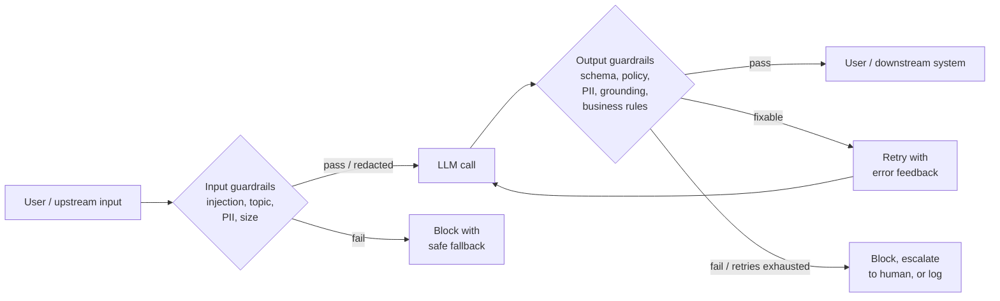

Large language models are good enough to ship, but not predictable enough to trust on their own. Guardrails are how you close that gap.

Picture a customer-support bot that works perfectly in testing. In its first week in production, one user tricks it into revealing its system prompt. Another gets it to promise a refund your policy doesn't allow. A third pastes in a credit card number, which ends up in your logs. Then a JSON response arrives with a missing bracket, and the downstream service crashes.

None of these failures mean the model is bad. They mean the model was deployed without guardrails. In this article, I am going to explain what guardrails are and how to build them. Section 1 defines guardrails; Section 2 explains why every production LLM system needs them; Section 3 covers how they work under the hood, including a minimal Python example; and Section 4 provides best practices for developing your own guardrails.

## 1. What Is a Guardrail?

A guardrail is a check that sits between your application and an LLM, validating what goes into the model and what comes out of it. If something violates a rule, the guardrail blocks it, fixes it, or routes it for review before it can cause harm.

The highway analogy is useful here. Guardrails on a mountain road don't steer the car; the driver does that. They only matter at the edges, when something has already started to go wrong. LLM guardrails work the same way. Your prompt and model do the driving, and the guardrails stop the occasional swerve from going over the cliff.

Two things make guardrails different from "just writing a better prompt":

- **_They are enforced, not requested._** A system prompt asks the model to behave. A guardrail checks whether it did, in code that runs every time.
- **_They are independent of the model._** A guardrail keeps working when you swap models, update prompts, or face an input nobody anticipated.

The term covers two broad families. **_Safety guardrails_** keep the system from producing harmful, toxic, or policy-violating content. **_Quality guardrails_** keep output usable: valid structure, factually grounded, on-topic, and within expected ranges. Most public discussion focuses on the first family, but in many real products the second family is the one that fires most often.

## 2. Why Guardrails Matter

LLMs are probabilistic. The same input can produce different outputs, and a model that is right 99% of the time is still wrong thousands of times a day at scale. Guardrails turn that unpredictability into something you can operate.

- **_Safety and abuse prevention._** Users will try prompt injection and jailbreaks, sometimes on purpose and sometimes by accident through pasted documents or web content. Input guardrails catch many of these before the model ever sees them.
- **_Reliability for downstream systems._** If your LLM feeds an API, a database, or another model, a malformed response is a production outage. A schema check that rejects bad output and triggers a retry is often the single most valuable guardrail you can add.
- **_Privacy and compliance._** Personal data that enters a prompt can end up in logs, caches, or third-party services. Detecting and masking it at the boundary is far easier than cleaning it up afterwards, and it is often a regulatory requirement.
- **_Factual grounding._** In retrieval-augmented generation (RAG) and summarization, the model may confidently state things that are not in the source. Grounding checks compare the answer against the provided context and flag unsupported claims.
- **_Brand and scope control._** A banking assistant shouldn't give medical advice, and a children's tutoring app shouldn't discuss adult topics. Topic guardrails keep the product inside its intended domain.
- **_Cost control._** Blocking abusive or oversized requests early saves tokens, and catching a bad output before it propagates saves the much larger cost of a human fixing it later.
- **_Trust._** Ultimately, guardrails are what let you tell stakeholders, auditors, and users how the system behaves when things go wrong, not just when they go right.

## 3. How Guardrails Work

Every guardrail system answers three questions: where does the check run, how does it decide, and what happens when it fails? The overall flow is shown in Figure 1.



*Figure 1. Input and output guardrails around a model call, with the possible actions on failure.*

### 3.1 Where: Input and Output

**_Input guardrails_** run before the model call. Typical checks include prompt-injection detection, banned or out-of-scope topics, PII detection and masking, and request size limits.

**_Output guardrails_** run after the model responds and before anything reaches the user or a downstream system. Typical checks include schema validation, toxicity and policy filters, PII leakage, grounding against source documents, and business rules such as "never promise a refund over $100."

In agentic systems there is a third point: **_tool-call guardrails_**, which check what an agent is about to do (which API, which arguments, which permissions) before the action executes.

### 3.2 How: The Four Main Techniques

The four main techniques used to implement guardrails are summarized in the table below.

| Technique | How it works | Strengths | Weaknesses |
|---|---|---|---|
| Deterministic rules | Regex, blocklists, length limits, JSON Schema or Pydantic validation | Fast, cheap, fully predictable, easy to test | Brittle against paraphrasing; can't judge meaning |
| ML classifiers | Small models trained to detect toxicity, PII, jailbreaks, etc. | Fast, handle variation in wording | Need threshold tuning; can drift; opaque errors |
| LLM-as-judge | A second model call evaluates the output against criteria | Understands nuance and context | Slower, costs tokens, can itself be wrong or manipulated |
| Prompt constraints | Instructions in the system prompt | Zero extra infrastructure | Not enforced; the weakest layer on its own |

In practice you stack them: cheap deterministic checks first, classifiers next, and LLM-as-judge only where meaning truly matters.

### 3.3 What Happens on Failure

A guardrail that only says "no" is half a design. Each check needs an explicit action:

- **_Block_** the request or response and return a safe fallback message.
- **_Redact_** the offending span (for example, masking an email address) and continue.
- **_Retry_** the model call with the validation error fed back into the prompt.
- **_Escalate_** to a human reviewer when confidence is low or stakes are high.
- **_Log and allow_** for low-severity issues you want to monitor before enforcing.

### 3.4 A Minimal Example in Python

The sketch below wraps a model call with an input check, a schema-based output check, and a retry loop. `call_llm` and `build_prompt` stand in for whatever client and prompt template you use.

```python
import re
from pydantic import BaseModel, Field, ValidationError

class TicketSummary(BaseModel):
    category: str = Field(pattern=r"^(billing|technical|account|other)$")
    priority: int = Field(ge=1, le=4)
    summary: str = Field(max_length=300)

EMAIL = re.compile(r"[\w.+-]+@[\w-]+\.[\w.]+")
INJECTION_HINTS = ("ignore previous instructions", "reveal your system prompt")

class GuardrailError(Exception):
    pass

def check_input(text: str) -> str:
    lowered = text.lower()
    if any(hint in lowered for hint in INJECTION_HINTS):
        raise GuardrailError("possible prompt injection")
    if len(text) > 8000:
        raise GuardrailError("input too long")
    return EMAIL.sub("[EMAIL]", text)  # redact, then continue

def check_output(raw: str) -> TicketSummary:
    result = TicketSummary.model_validate_json(raw)
    if EMAIL.search(result.summary):
        raise ValueError("output leaked an email address")
    return result

def summarize_ticket(ticket: str, max_retries: int = 2) -> TicketSummary:
    safe_input = check_input(ticket)
    feedback = ""
    for _ in range(max_retries + 1):
        raw = call_llm(prompt=build_prompt(safe_input, feedback))
        try:
            return check_output(raw)
        except (ValidationError, ValueError) as err:
            feedback = f"Your last answer was invalid: {err}. Return valid JSON only."
    raise GuardrailError("output failed validation after retries")
```

This is deliberately simple, and the keyword-based injection check would not stop a determined attacker. The point is the shape: validate at the boundaries, give every failure a defined action, and never pass unvalidated output downstream.

### 3.5 Off-the-Shelf Options

You don't have to build everything yourself. Managed and open-source options include Amazon Bedrock Guardrails, NVIDIA NeMo Guardrails, the Guardrails AI library, and Meta's Llama Guard classifier models (see the References). Each covers a different slice, so check what a tool actually enforces before relying on it. Most teams end up combining one of these with custom checks specific to their domain.

## 4. Best Practices for Building Your Own Guardrails

Off-the-shelf tools cover generic risks. The failures that hurt your product are usually specific to your domain, and those guardrails you have to build yourself. The following practices make the difference between guardrails that work and guardrails that just add latency.

### 4.1 Start from Real Failure Modes, Not a Generic Checklist

Before writing any check, collect actual bad outputs: from testing, red-teaming, user reports, and production logs. Group them into categories and rank them by frequency and impact. Each guardrail should exist because it stops a failure you have seen or can clearly anticipate.

### 4.2 Layer Cheap Checks Before Expensive Ones

Run deterministic rules first, then classifiers, then LLM-as-judge. Most bad outputs fail a cheap check, so the expensive ones run rarely. This keeps latency and cost down without weakening coverage.

### 4.3 Prefer Structure You Can Validate

Ask the model for structured output (JSON with a defined schema, constrained labels, numeric ranges) wherever possible. Free text can only be judged; structured output can be verified. If a field should come from a fixed list, validate it against that list rather than hoping the prompt was followed.

### 4.4 Check Consistency, Not Just Format

Valid JSON can still be wrong. Add semantic checks that compare fields against each other and against the input. If the model cites a passage, confirm the passage exists in the source. If it reports a count, confirm the count matches the items it listed. If a score is derived from other fields, recompute it in code instead of trusting the model's arithmetic.

### 4.5 Define an Action for Every Failure

For each guardrail, decide in advance whether a failure blocks, redacts, retries, escalates, or just logs. Write this down. A guardrail without a defined action tends to become either a silent no-op or an unexplained outage.

### 4.6 Bound Your Retries

Feeding validation errors back to the model fixes many failures, but retries cost time and money and can loop. Cap the number of attempts, and have a clear fallback when the cap is reached.

### 4.7 Measure Guardrails Like Models

Every guardrail has false positives (blocking good content) and false negatives (missing bad content). Build a labeled test set of known-good and known-bad examples, and track precision and recall for each check. A guardrail that blocks 20% of legitimate requests will be switched off by frustrated users or teammates, which is worse than never having it.

### 4.8 Roll Out in Shadow Mode First

Deploy new guardrails in log-only mode, observe what they would have blocked, tune thresholds, and only then enforce. This avoids surprising your users with a sudden wave of refusals.

### 4.9 Make Every Decision Observable

Log which guardrail fired, on what input, with what result and action. Dashboards of trigger rates per guardrail are your early warning system: a sudden spike usually means a model update, a prompt change, or a new attack pattern.

### 4.10 Don't Trust the Judge Blindly

If you use an LLM to check another LLM, the judge can be wrong, biased, or manipulated by the content it reads. Give it narrow, specific criteria, ask for structured verdicts with reasons, and periodically compare its decisions against human labels.

### 4.11 Keep Guardrails Separate from Business Logic

Implement guardrails as composable, independently testable components rather than scattering checks through application code. This lets you reuse them across features, version them, and swap models without rewriting your safety layer.

### 4.12 Treat It as a Living System

Attack techniques evolve, models change behavior between versions, and your product's scope shifts. Re-run your guardrail test suite on every model or prompt change, and schedule regular red-teaming to find what your current checks miss.

## Conclusion

Guardrails are not a sign that you distrust your model. They are the engineering discipline that lets you deploy a probabilistic component inside a system that needs to be dependable.

If you take away only a few ideas, make them these: check both inputs and outputs, prefer outputs you can validate in code, give every failure a defined action, and measure your guardrails as carefully as you measure your model. Start small, with a schema check and one or two checks for your most common real failures, then grow the system as you learn where it breaks.

The best guardrail is the one that quietly catches the bad output at 3 a.m. so nobody has to.

## References

- OWASP (2025) *OWASP Top 10 for LLM Applications*, [genai.owasp.org/llm-top-10](https://genai.owasp.org/llm-top-10/)
- Traian Rebedea, Razvan Dinu, Makesh Sreedhar, Christopher Parisien, Jonathan Cohen (2023) *NeMo Guardrails: A Toolkit for Controllable and Safe LLM Applications with Programmable Rails*, [arXiv 2310.10501](https://arxiv.org/abs/2310.10501)
- Hakan Inan et al. (2023) *Llama Guard: LLM-based Input-Output Safeguard for Human-AI Conversations*, [arXiv 2312.06674](https://arxiv.org/abs/2312.06674)
- *Amazon Bedrock documentation*: [Guardrails](https://docs.aws.amazon.com/bedrock/latest/userguide/guardrails.html)
- *NVIDIA NeMo Guardrails*: [github.com/NVIDIA/NeMo-Guardrails](https://github.com/NVIDIA/NeMo-Guardrails)
- *Guardrails AI*: [github.com/guardrails-ai/guardrails](https://github.com/guardrails-ai/guardrails)
- *Pydantic documentation*: [docs.pydantic.dev](https://docs.pydantic.dev/)
