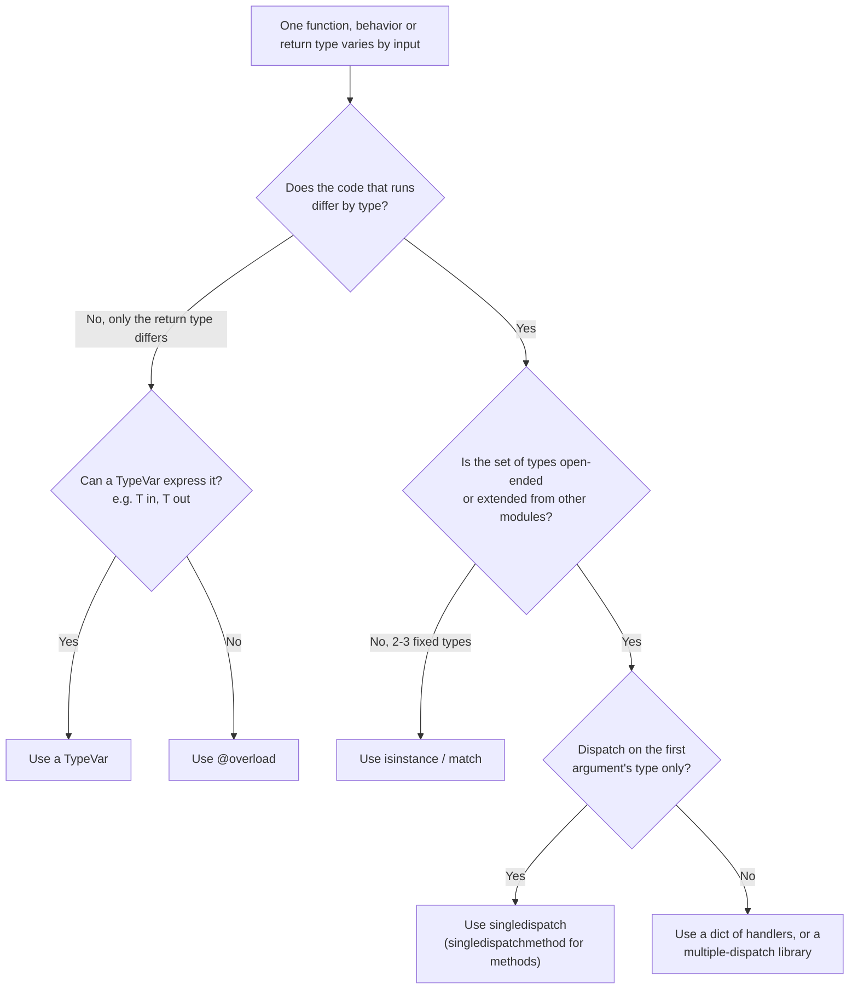

*One describes signatures to the type checker, the other picks the implementation at runtime*

Anyone coming to Python from C++, Java or C# eventually looks for function overloading, i.e., several functions with the same name, distinguished by their parameter types. Python does not have it, at least not in that form. What it has instead are two tools with confusingly similar purposes: `typing.overload` and `functools.singledispatch`. Both are often described as "overloading", and both are about "one function name, different behavior per type", yet they work at completely different layers of the language.

This post explains why Python has no classic overloading, what `@overload` and `singledispatch` actually do (including what happens under the hood), how the two relate to each other, and when to use which. All code below was run with Python 3.12, and the type-checker output comes from mypy.

## 1. Python Has No Overloading (and Why)

### 1.1 The Last `def` Wins

In Python, `def` is an executable statement which creates a function object and binds it to a name. Defining a second function with the same name simply rebinds that name, and the first function is gone:

```python
def area(side):
    return side * side

def area(width, height):
    return width * height

print(area(3, 4))
area(3)
```

Running the code above gives:

```text
12
TypeError: area() missing 1 required positional argument: 'height'
```

There is no table of signatures behind the name `area`, only one function object. This is a direct consequence of Python's design: names are just references, and since function arguments carry no declared types at runtime, the interpreter has nothing to choose between overloads anyway.

### 1.2 The Four Meanings of "Overloading" in Python

So when Python developers talk about overloading, they usually mean one of four different things:

1. ***Flexible parameters***: default values, `*args` / `**kwargs`, and `isinstance` checks or `match` statements inside one function. This is the most common and most idiomatic approach.
2. ***Operator overloading***: dunder methods like `__add__` and `__eq__`. This is the only kind of overloading the language itself has. `a + b` calls `type(a).__add__(a, b)`, falls back to `type(b).__radd__(b, a)` on `NotImplemented`, and raises `TypeError` if both fail.
3. ***`typing.overload`***: multiple signatures for one function, for the type checker only.
4. ***`functools.singledispatch`***: multiple implementations for one function, selected at runtime by the type of the first argument.

The rest of this post is about the last two, since they are the ones that get confused.

## 2. `typing.overload`: Overloading for the Type Checker

### 2.1 The Problem It Solves

Many functions return different types depending on what is passed in. Without `@overload`, the only way to annotate such a function is a union, and a union loses information. Consider a lookup with an optional default:

```python
def get_score(key: str, default: int | None = None) -> int | None:
    scores = {"alice": 90}
    return scores.get(key, default)

score = get_score("bob", 0)
print(score + 10)
```

The code runs fine, since a default was passed and `score` can never be `None`. But mypy disagrees:

```text
error: Unsupported operand types for + ("None" and "int")  [operator]
note: Left operand is of type "int | None"
```

The type checker only sees the declared return type `int | None`. It has no way to know that passing a `default` rules out `None`. The usual workarounds, i.e., `assert score is not None`, `cast(int, score)`, or `# type: ignore`, all push the burden onto every caller.

### 2.2 Describing Each Call Pattern

`@overload` lets the function describe each input-to-output relationship separately:

```python
from typing import overload

@overload
def get_score(key: str) -> int | None: ...
@overload
def get_score(key: str, default: int) -> int: ...
def get_score(key: str, default: int | None = None) -> int | None:
    scores = {"alice": 90}
    return scores.get(key, default)

a = get_score("bob", 0)
b = get_score("bob")
reveal_type(a)
reveal_type(b)
```

Now mypy picks the matching signature for each call:

```text
note: Revealed type is "int"
note: Revealed type is "int | None"
Success: no issues found in 1 source file
```

The structure is always the same: two or more `@overload`-decorated stubs whose bodies are just `...`, followed by exactly one undecorated implementation. The implementation's own signature must be general enough to accept every overload, and it is not visible to callers.

Another common pattern uses `Literal` to make a flag change the return type, which is exactly how the standard library annotates `open()`:

```python
from typing import Literal, overload

@overload
def load(path: str, binary: Literal[True]) -> bytes: ...
@overload
def load(path: str, binary: Literal[False] = ...) -> str: ...
def load(path: str, binary: bool = False) -> str | bytes:
    with open(path, "rb" if binary else "r") as f:
        return f.read()

reveal_type(load("notes.txt"))
reveal_type(load("logo.png", binary=True))
```

```text
note: Revealed type is "str"
note: Revealed type is "bytes"
```

### 2.3 What Happens at Runtime

Here is the part that surprises people: at runtime, `@overload` does nothing useful. The decorator records the stub in a registry (retrievable with `typing.get_overloads` since Python 3.11) and returns a dummy function that refuses to be called:

```python
from typing import overload

@overload
def double(x: int) -> int: ...

double(21)   # only a stub exists so far
```

```text
NotImplementedError: You should not call an overloaded function. A series of
@overload-decorated functions outside a stub module should always be followed
by an implementation that is not @overload-ed.
```

Once the undecorated implementation is defined, it rebinds the name, just like in Section 1.1. So at runtime there is only one function, and if the behavior differs by type, it is still the implementation's job to branch on it.

A few things to notice from this section:

- `@overload` changes what the type checker infers. It never changes which code runs.
- The implementation body is not checked against each overload individually. If the stubs promise `int` for some input and the body returns `None`, mypy will not catch it. The stubs are a contract that the implementation has to honor.
- Before reaching for `@overload`, check if a `TypeVar` is enough. `def first(xs: list[T]) -> T` expresses "same type in, same type out" in one line, while overloads are needed when the relationship cannot be written as a single generic signature.

## 3. `functools.singledispatch`: Overloading at Runtime

### 3.1 The Problem It Solves

Now consider a different problem: converting values to JSON-compatible objects. The usual first version is an `isinstance` ladder:

```python
def to_json(obj):
    if isinstance(obj, date):
        return obj.isoformat()
    elif isinstance(obj, Decimal):
        return str(obj)
    elif isinstance(obj, (list, tuple)):
        return [to_json(x) for x in obj]
    ...
```

This works until the ladder starts growing, and every new type requires editing this one function, in the module that owns it. If a separate package wants to make its own types serializable, it cannot do it without touching this code. `singledispatch` turns such a function into a ***generic function***, whose implementations can be registered from anywhere.

### 3.2 Basic Usage

```python
from datetime import date, datetime
from decimal import Decimal
from functools import singledispatch

@singledispatch
def to_json(obj):
    raise TypeError(f"Cannot serialize {type(obj).__name__}")

@to_json.register
def _(obj: date):
    return obj.isoformat()

@to_json.register
def _(obj: Decimal):
    return str(obj)

@to_json.register
def _(obj: list | tuple):             # union annotations: Python 3.11+
    return [to_json(x) for x in obj]

@to_json.register(int)                # explicit type, no annotation needed
@to_json.register(str)
def _(obj):
    return obj

print(to_json([Decimal("19.99"), date(2026, 11, 18), "ok", 42]))
print(to_json(datetime(2026, 11, 18, 9, 30)))
print(to_json(True))
to_json(b"raw")
```

Running the code above gives:

```text
['19.99', '2026-11-18', 'ok', 42]
2026-11-18T09:30:00
True
TypeError: Cannot serialize bytes
```

The decorated function becomes the fallback for `object`, and `register` adds one implementation per type, taking the type either from the first parameter's annotation or from an explicit argument. The implementations are usually named `_`, since they are only ever called through the generic function.

Two lines of the output are worth a closer look. `datetime` was never registered, yet it was handled by the `date` implementation, and `True` was handled by the `int` implementation. This leads to how dispatch actually chooses.

### 3.3 Dispatch Follows the MRO

`singledispatch` does not require an exact type match. It walks the ***method resolution order*** (MRO) of the argument's class and picks the most specific registered type. Since `datetime` is a subclass of `date`, and `bool` is a subclass of `int`, they fall back to their parents' implementations. Registering a more specific type overrides that:

```python
@to_json.register
def _(obj: datetime):
    return obj.isoformat(timespec="minutes") + "Z"

print(to_json(date(2026, 11, 18)))
print(to_json(datetime(2026, 11, 18, 9, 30)))
print([c.__name__ for c in datetime.__mro__])
```

```text
2026-11-18
2026-11-18T09:30Z
['datetime', 'date', 'object']
```

This is the same rule as method overriding in a class hierarchy, which makes the behavior predictable.

Dispatch also understands abstract base classes, including virtual subclasses that are registered after the fact:

```python
from collections.abc import Mapping, Sequence
from functools import singledispatch

@singledispatch
def describe(obj):
    return "something else"

@describe.register
def _(obj: Mapping):
    return f"mapping with {len(obj)} keys"

@describe.register
def _(obj: Sequence):
    return f"sequence of {len(obj)}"

class Row:                       # does not inherit from Sequence...
    def __init__(self, *cells): self.cells = cells
    def __len__(self): return len(self.cells)
    def __getitem__(self, i): return self.cells[i]

print(describe({"a": 1}))
print(describe((1, 2, 3)))
print(describe(Row(1, 2)))
Sequence.register(Row)           # ...until it is registered as a virtual subclass
print(describe(Row(1, 2)))
```

```text
mapping with 1 keys
sequence of 3
something else
sequence of 2
```

### 3.4 Methods: `singledispatchmethod`

`singledispatch` dispatches on the first argument, which for a method would be `self`. For methods, `functools.singledispatchmethod` dispatches on the first argument ***after*** `self`:

```python
from functools import singledispatchmethod

class Formatter:
    def __init__(self, precision: int = 2):
        self.precision = precision

    @singledispatchmethod
    def fmt(self, value):
        return str(value)

    @fmt.register
    def _(self, value: float):
        return f"{value:.{self.precision}f}"

    @fmt.register
    def _(self, value: list):
        return ", ".join(self.fmt(v) for v in value)

f = Formatter(precision=3)
print(f.fmt(3.14159))
print(f.fmt([1.5, "n/a", 2]))
```

```text
3.142
1.500, n/a, 2
```

### 3.5 Under the Hood

The real implementation lives in `Lib/functools.py`, and its core idea fits in about 20 lines. The toy version below is enough to see the mechanism:

```python
def tiny_dispatch(base):
    registry = {object: base}

    def register(cls):
        def deco(func):
            registry[cls] = func
            return func
        return deco

    def wrapper(arg, *args, **kwargs):
        for cls in type(arg).__mro__:          # most specific class first
            if cls in registry:
                return registry[cls](arg, *args, **kwargs)

    wrapper.register = register
    return wrapper

@tiny_dispatch
def show(x):
    return f"object: {x!r}"

@show.register(int)
def _(x):
    return f"int: {x}"

print(show(7), "|", show(True), "|", show("hi"))
```

```text
int: 7 | int: True | object: 'hi'
```

The real `singledispatch` adds three things on top of this:

- ***ABC-aware MRO***. Instead of the plain `__mro__`, it builds a merged MRO that also includes the relevant abstract base classes (`_compose_mro`), which is why the `Row` example above works.
- ***A dispatch cache***. Walking the MRO on every call would be slow, so results are cached per class in a `WeakKeyDictionary`. The cache is cleared when a new implementation is registered, or when the ABC registry changes (tracked by `abc.get_cache_token()`).
- ***Introspection***. `to_json.registry` is a read-only view of the type-to-implementation mapping, and `to_json.dispatch(cls)` returns the implementation that would be used for `cls`, which is handy when debugging.

### 3.6 The Type Checker's Blind Spot

One thing `singledispatch` does not do is inform the type checker. mypy sees only the base function's signature. If that signature is unannotated or accepts `object`, any argument passes the type check, even one with no registered implementation:

```python
from functools import singledispatch

@singledispatch
def area(shape) -> float:
    raise NotImplementedError(f"no area for {type(shape).__name__}")

@area.register
def _(shape: int) -> float:
    return float(shape * shape)

area(b"oops")      # mypy: Success. Runtime: NotImplementedError
```

In other words, `singledispatch` gives runtime flexibility at the cost of static precision. If callers should be told which types are supported, annotate the base function's parameter with a union of those types. The trade-off is that the union has to be updated whenever a new type is registered, which defeats part of the purpose of open extension.

## 4. How They Relate

The two tools share a vocabulary but answer different questions. `@overload` answers ***"what type does this call return?"***, for a tool that reads the code. `singledispatch` answers ***"which code runs for this argument?"***, for the interpreter. The table below summarizes the differences.

| | `typing.overload` | `functools.singledispatch` |
|---|---|---|
| Acts at | Static analysis time | Runtime |
| Changes behavior? | No, signatures only | Yes, selects the implementation |
| Dispatches on | All arguments, arity, literal values | Type of the first argument only |
| Implementations | One body; branch inside if needed | One body per registered type |
| Extensible from other modules? | No, fixed where it is defined | Yes, anyone can `register` |
| Visible to type checkers? | Yes, that is the whole point | Only the base signature |
| Main beneficiary | Callers and their tooling | The program's structure |

Seen this way, they are not competitors. A function can need neither, either, or both. A useful way to put it: `@overload` documents a function's behavior precisely, and `singledispatch` organizes the code that implements it.

## 5. When to Use Which

The flowchart below summarizes the decision.



### 5.1 Use `@overload` When

- An optional argument changes whether `None` can be returned (the `get_score` example).
- A flag or mode argument changes the return type (the `load` example, `open()`, `subprocess.run(text=True)`).
- Different argument counts mean different things, e.g., `range(stop)` vs. `range(start, stop)`.
- You are writing a library or shared module whose callers run a type checker. This is where `@overload` pays off most, since every caller benefits.

Skip it in application code where nobody benefits from the extra precision, and whenever a `TypeVar` or a plain union is good enough.

### 5.2 Use `singledispatch` When

- Behavior genuinely differs by type, and the set of types is open-ended: serializers, pretty-printers, validators, converters, visitors over trees and ASTs.
- Other modules or third-party plugins need to add support for their own types without editing your code.
- You need to add an operation to types you do not own, like `datetime`, `Decimal`, or classes from another library, which you cannot extend with methods.

Skip it when:

- There are only two or three fixed types. A short `isinstance` check or a `match` statement is clearer and easier to follow.
- The types are classes you own. Ordinary methods and polymorphism are the more natural fit.
- The choice depends on values rather than types, e.g., `"csv"` vs. `"json"`. A dictionary of handlers fits better.
- The choice depends on the types of several arguments. `singledispatch` only looks at the first one; libraries like `plum` or `multipledispatch` handle multiple dispatch.

## 6. Common Pitfalls

A few mistakes come up repeatedly with these two tools:

- ***Expecting `@overload` to dispatch.*** Writing several `@overload` functions with real bodies and expecting Python to pick one at runtime. Only the final undecorated implementation ever runs.
- ***Forgetting the implementation.*** A series of `@overload` stubs without a final implementation leaves the name bound to the dummy, which raises `NotImplementedError` when called (Section 2.3).
- ***Using `singledispatch` on a method.*** It will dispatch on `self`, which is almost never what is intended. Use `singledispatchmethod`.
- ***Registering a type that is too general.*** Since dispatch follows the MRO, registering very broad ABCs such as `Hashable` or `Iterable` can capture types you did not expect (`str` is an `Iterable`, for example). Register the most specific types that make sense.
- ***Relying on registration side effects.*** Implementations registered in another module only exist after that module has been imported. If a plugin's registration lives in a module nobody imports, dispatch silently falls back to the base function.

## Conclusion

Python has no classic function overloading, because a function name is just a reference to a single function object. What it offers instead are two tools at two different layers. `typing.overload` describes the different signatures of one function to the type checker, so that each call pattern gets a precise return type, while the code that runs stays the same. `functools.singledispatch` selects a different implementation at runtime based on the type of the first argument, following the MRO and supporting registration from anywhere, while remaining mostly invisible to the type checker. The rule of thumb is simple: if callers' type checkers are confused about what a function returns, reach for `@overload`; if a function is growing an `isinstance` ladder that other modules keep needing to extend, reach for `singledispatch`.

## References

- J. van Rossum, J. Lehtosalo, Ł. Langa (2014) *PEP 484: Type Hints*, [peps.python.org/pep-0484](https://peps.python.org/pep-0484/)
- Ł. Langa (2013) *PEP 443: Single-dispatch generic functions*, [peps.python.org/pep-0443](https://peps.python.org/pep-0443/)
- *Python documentation*: [`typing.overload`](https://docs.python.org/3/library/typing.html#typing.overload) and [`functools.singledispatch`](https://docs.python.org/3/library/functools.html#functools.singledispatch)
- *mypy documentation*: [Function overloading](https://mypy.readthedocs.io/en/stable/more_types.html#function-overloading)
- *CPython source*: [`Lib/functools.py`](https://github.com/python/cpython/blob/main/Lib/functools.py)
