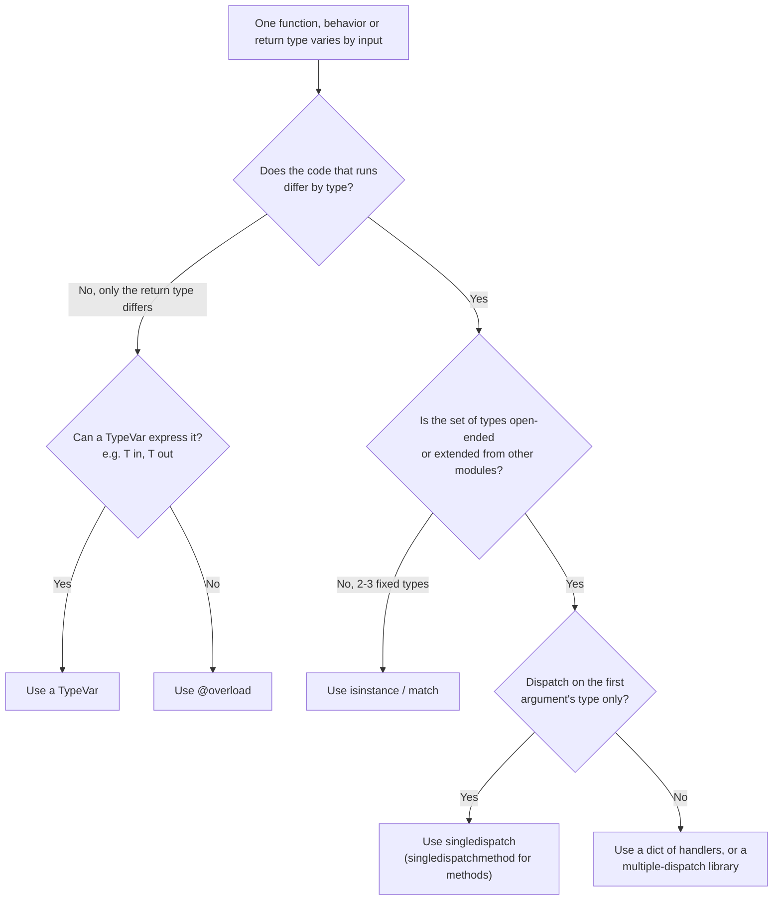

For developers coming to Python from C++, Java or C#, function overloading, i.e., defining several functions with the same name that are distinguished by their parameter types, is a familiar tool. Python does not support it, at least not in that form. Instead, it provides two tools that are both often described as "overloading": `typing.overload` and `functools.singledispatch`. Both are about one function name behaving differently for different types, but they work at completely different layers of the language: the former only affects static type checking, while the latter selects the implementation at runtime.

In this article, I am going to explain the difference between the two tools, and how and when to use each of them. Section 1 explains why Python has no classic overloading; Sections 2 and 3 cover `typing.overload` and `functools.singledispatch` respectively, including what happens under the hood; Section 4 compares the two; and Sections 5 and 6 provide guidelines on when to use which, together with the common pitfalls. All code in this article was run with Python 3.12, and the type checker output comes from mypy.

## 1. Python Has No Overloading (and Why)

### 1.1 The Last `def` Wins

In Python, `def` is an executable statement which creates a function object and binds it to a name. Defining a second function with the same name simply rebinds that name, and the first function is gone:

```python
def area(side):
    return side * side

def area(width, height):
    return width * height

print(area(3, 4))
area(3)
```

Running the code above gives:

```text
12
TypeError: area() missing 1 required positional argument: 'height'
```

As the output shows, there is no table of signatures behind the name `area`, but only one function object. This is a direct consequence of Python's design: names are just references, and since function arguments carry no declared types at runtime, the interpreter would have nothing to choose between overloads anyway.

### 1.2 The Four Meanings of "Overloading" in Python

Accordingly, when Python developers talk about overloading, they usually mean one of the following four things:

1. **_Flexible parameters_**: default values, `*args` / `**kwargs`, and `isinstance` checks or `match` statements inside one function. This is the most common and the most idiomatic approach.
2. **_Operator overloading_**: dunder methods like `__add__` and `__eq__`. This is the only kind of overloading the language itself has. `a + b` calls `type(a).__add__(a, b)`, falls back to `type(b).__radd__(b, a)` if the former returns `NotImplemented`, and raises `TypeError` if both fail.
3. **_`typing.overload`_**: multiple signatures for one function, for the type checker only.
4. **_`functools.singledispatch`_**: multiple implementations for one function, selected at runtime based on the type of the first argument.

The rest of this article focuses on the last two, since they are the ones that are most often confused with each other.

## 2. `typing.overload`: Overloading for the Type Checker

### 2.1 The Problem It Solves

Many functions return different types depending on their input. Without `@overload`, the only way to annotate such a function is to use a union, which loses information. Consider the following lookup function with an optional default:

```python
def get_score(key: str, default: int | None = None) -> int | None:
    scores = {"alice": 90}
    return scores.get(key, default)

score = get_score("bob", 0)
print(score + 10)
```

The code runs without any problem, since a default is passed and `score` can never be `None`. However, mypy reports an error:

```text
error: Unsupported operand types for + ("None" and "int")  [operator]
note: Left operand is of type "int | None"
```

This is because the type checker only sees the declared return type `int | None`, and it has no way to know that passing a `default` rules out `None`. The usual workarounds, i.e., `assert score is not None`, `cast(int, score)`, or `# type: ignore`, all push the burden onto every caller.

### 2.2 Describing Each Call Pattern

With `@overload`, each relationship between the input and the output can be described separately:

```python
from typing import overload

@overload
def get_score(key: str) -> int | None: ...
@overload
def get_score(key: str, default: int) -> int: ...
def get_score(key: str, default: int | None = None) -> int | None:
    scores = {"alice": 90}
    return scores.get(key, default)

a = get_score("bob", 0)
b = get_score("bob")
reveal_type(a)
reveal_type(b)
```

Now mypy picks the matching signature for each call:

```text
note: Revealed type is "int"
note: Revealed type is "int | None"
Success: no issues found in 1 source file
```

The structure is always the same: two or more stubs decorated with `@overload`, whose bodies are just `...`, followed by exactly one implementation without the decorator. Note that the signature of the implementation must be general enough to accept every overload, and it is not visible to the callers.

Another common pattern uses `Literal`, so that a flag argument changes the return type. This is exactly how `open()` is annotated in the standard library:

```python
from typing import Literal, overload

@overload
def load(path: str, binary: Literal[True]) -> bytes: ...
@overload
def load(path: str, binary: Literal[False] = ...) -> str: ...
def load(path: str, binary: bool = False) -> str | bytes:
    with open(path, "rb" if binary else "r") as f:
        return f.read()

reveal_type(load("notes.txt"))
reveal_type(load("logo.png", binary=True))
```

```text
note: Revealed type is "str"
note: Revealed type is "bytes"
```

### 2.3 What Happens at Runtime

At runtime, however, `@overload` does nothing useful, which often surprises people. The decorator records the stub in a registry (retrievable with `typing.get_overloads` since Python 3.11), and returns a dummy function that raises an error when called:

```python
from typing import overload

@overload
def double(x: int) -> int: ...

double(21)   # only a stub exists so far
```

```text
NotImplementedError: You should not call an overloaded function. A series of
@overload-decorated functions outside a stub module should always be followed
by an implementation that is not @overload-ed.
```

Once the undecorated implementation is defined, it rebinds the name, just as in Section 1.1. Therefore, at runtime there is still only one function, and if the behavior depends on the argument types, it is still the implementation's job to branch on them.

To summarize this section, three points are worth noting:

- `@overload` changes what the type checker infers, but it never changes which code runs.
- The implementation body is not checked against each overload individually. If a stub promises `int` for some input while the body returns `None`, mypy will not catch it. The stubs are a contract which the implementation has to honor.
- Before reaching for `@overload`, it is worth checking whether a `TypeVar` is sufficient. `def first(xs: list[T]) -> T` expresses "same type in, same type out" in one line; overloads are only needed when the relationship cannot be written as a single generic signature.

## 3. `functools.singledispatch`: Overloading at Runtime

### 3.1 The Problem It Solves

Now consider a different problem: converting values to JSON-compatible objects. The first version is usually an `isinstance` ladder:

```python
def to_json(obj):
    if isinstance(obj, date):
        return obj.isoformat()
    elif isinstance(obj, Decimal):
        return str(obj)
    elif isinstance(obj, (list, tuple)):
        return [to_json(x) for x in obj]
    ...
```

This approach works fine at first. As the ladder grows, however, every new type requires editing this one function, in the module that owns it, and a separate package cannot make its own types serializable without touching this code. `singledispatch` solves this problem by turning such a function into a **_generic function_**, whose implementations can be registered from anywhere.

### 3.2 Basic Usage

```python
from datetime import date, datetime
from decimal import Decimal
from functools import singledispatch

@singledispatch
def to_json(obj):
    raise TypeError(f"Cannot serialize {type(obj).__name__}")

@to_json.register
def _(obj: date):
    return obj.isoformat()

@to_json.register
def _(obj: Decimal):
    return str(obj)

@to_json.register
def _(obj: list | tuple):             # union annotations: Python 3.11+
    return [to_json(x) for x in obj]

@to_json.register(int)                # explicit type, no annotation needed
@to_json.register(str)
def _(obj):
    return obj

print(to_json([Decimal("19.99"), date(2026, 11, 18), "ok", 42]))
print(to_json(datetime(2026, 11, 18, 9, 30)))
print(to_json(True))
to_json(b"raw")
```

Running the code above gives:

```text
['19.99', '2026-11-18', 'ok', 42]
2026-11-18T09:30:00
True
TypeError: Cannot serialize bytes
```

The decorated function becomes the fallback implementation for `object`, and `register` adds one implementation per type. The type is taken either from the annotation of the first parameter, or from an explicit argument to `register`. The implementations are usually named `_`, since they are only called through the generic function.

Note that `datetime` was never registered, yet it was handled by the `date` implementation; similarly, `True` was handled by the `int` implementation. The reason lies in how dispatch chooses the implementation, which is explained in the next section.

### 3.3 Dispatch Follows the MRO

`singledispatch` does not require the type to match exactly. Instead, it walks through the **_method resolution order_** (MRO) of the argument's class, and picks the most specific registered type. Since `datetime` is a subclass of `date`, and `bool` is a subclass of `int`, they fall back to the implementations registered for their parent classes. Registering a more specific type overrides this behavior:

```python
@to_json.register
def _(obj: datetime):
    return obj.isoformat(timespec="minutes") + "Z"

print(to_json(date(2026, 11, 18)))
print(to_json(datetime(2026, 11, 18, 9, 30)))
print([c.__name__ for c in datetime.__mro__])
```

```text
2026-11-18
2026-11-18T09:30Z
['datetime', 'date', 'object']
```

This is the same rule as method overriding in a class hierarchy, so the behavior is predictable.

Dispatch also works with abstract base classes (ABCs), including virtual subclasses that are registered after the fact, as shown in the example below:

```python
from collections.abc import Mapping, Sequence
from functools import singledispatch

@singledispatch
def describe(obj):
    return "something else"

@describe.register
def _(obj: Mapping):
    return f"mapping with {len(obj)} keys"

@describe.register
def _(obj: Sequence):
    return f"sequence of {len(obj)}"

class Row:                       # does not inherit from Sequence...
    def __init__(self, *cells): self.cells = cells
    def __len__(self): return len(self.cells)
    def __getitem__(self, i): return self.cells[i]

print(describe({"a": 1}))
print(describe((1, 2, 3)))
print(describe(Row(1, 2)))
Sequence.register(Row)           # ...until it is registered as a virtual subclass
print(describe(Row(1, 2)))
```

```text
mapping with 1 keys
sequence of 3
something else
sequence of 2
```

### 3.4 Methods: `singledispatchmethod`

`singledispatch` dispatches on the first argument, which for a method is `self`. For methods, `functools.singledispatchmethod` should be used instead, which dispatches on the first argument **_after_** `self`:

```python
from functools import singledispatchmethod

class Formatter:
    def __init__(self, precision: int = 2):
        self.precision = precision

    @singledispatchmethod
    def fmt(self, value):
        return str(value)

    @fmt.register
    def _(self, value: float):
        return f"{value:.{self.precision}f}"

    @fmt.register
    def _(self, value: list):
        return ", ".join(self.fmt(v) for v in value)

f = Formatter(precision=3)
print(f.fmt(3.14159))
print(f.fmt([1.5, "n/a", 2]))
```

```text
3.142
1.500, n/a, 2
```

### 3.5 Under the Hood

The real implementation is in `Lib/functools.py`, but its core idea is simple enough to be captured in about 20 lines. The following simplified version is sufficient to show the mechanism:

```python
def tiny_dispatch(base):
    registry = {object: base}

    def register(cls):
        def deco(func):
            registry[cls] = func
            return func
        return deco

    def wrapper(arg, *args, **kwargs):
        for cls in type(arg).__mro__:          # most specific class first
            if cls in registry:
                return registry[cls](arg, *args, **kwargs)

    wrapper.register = register
    return wrapper

@tiny_dispatch
def show(x):
    return f"object: {x!r}"

@show.register(int)
def _(x):
    return f"int: {x}"

print(show(7), "|", show(True), "|", show("hi"))
```

```text
int: 7 | int: True | object: 'hi'
```

On top of this, the real `singledispatch` adds the following three features:

- **ABC-aware MRO.** Instead of the plain `__mro__`, it builds a merged MRO which also includes the relevant abstract base classes (`_compose_mro`). This is why the `Row` example in Section 3.3 works.
- **Dispatch cache.** Walking through the MRO on every call would be slow, so the results are cached per class in a `WeakKeyDictionary`. The cache is cleared whenever a new implementation is registered, or when the ABC registry changes (tracked by `abc.get_cache_token()`).
- **Introspection.** `to_json.registry` is a read-only view of the mapping from types to implementations, and `to_json.dispatch(cls)` returns the implementation that would be used for `cls`, which is handy for debugging.

### 3.6 The Type Checker's Blind Spot

Note that `singledispatch` provides no information to the type checker. mypy only sees the signature of the base function, so if that signature is unannotated or accepts `object`, any argument passes the type check, even if no implementation is registered for its type:

```python
from functools import singledispatch

@singledispatch
def area(shape) -> float:
    raise NotImplementedError(f"no area for {type(shape).__name__}")

@area.register
def _(shape: int) -> float:
    return float(shape * shape)

area(b"oops")      # mypy: Success. Runtime: NotImplementedError
```

In other words, `singledispatch` provides runtime flexibility at the cost of static precision. If the callers should be told which types are supported, the parameter of the base function can be annotated with a union of those types. The trade-off is that the union then has to be updated whenever a new type is registered, which partly defeats the purpose of open extension.

## 4. How They Relate

Although the two tools share the same vocabulary, they answer different questions. `@overload` answers the question of what type a call returns, and the answer is consumed by the type checker. `singledispatch` answers the question of which code runs for a given argument, and the answer is consumed by the interpreter. The differences are summarized in the table below.

| | `typing.overload` | `functools.singledispatch` |
|---|---|---|
| Acts at | Static analysis time | Runtime |
| Changes behavior? | No, signatures only | Yes, selects the implementation |
| Dispatches on | All arguments, arity, literal values | Type of the first argument only |
| Implementations | One body; branch inside if needed | One body per registered type |
| Extensible from other modules? | No, fixed where it is defined | Yes, anyone can `register` |
| Visible to type checkers? | Yes, that is its whole purpose | Only the base signature |
| Main beneficiary | Callers and their tooling | The structure of the program |

Therefore, the two tools do not compete with each other, and a function may need neither, either, or both of them: `@overload` describes the behavior of a function precisely, while `singledispatch` organizes the code that implements it.

## 5. When to Use Which

The decision on which tool to use is summarized in Figure 1.



*Figure 1. Choosing between a `TypeVar`, `@overload`, `isinstance` / `match`, and `singledispatch`.*

### 5.1 When to Use `@overload`

`@overload` is the right tool in the following cases:

- An optional argument determines whether `None` can be returned (the `get_score` example in Section 2.2).
- A flag or mode argument changes the return type (the `load` example, `open()`, `subprocess.run(text=True)`).
- Different numbers of arguments mean different things, e.g., `range(stop)` vs. `range(start, stop)`.
- The function is part of a library or a shared module whose callers run a type checker. This is where `@overload` pays off the most, since every caller benefits from it.

On the other hand, it is not worth the effort in application code where nobody benefits from the extra precision, or whenever a `TypeVar` or a plain union is sufficient.

### 5.2 When to Use `singledispatch`

`singledispatch` is the right tool in the following cases:

- The behavior genuinely differs by type, and the set of types is open-ended, e.g., serializers, pretty-printers, validators, converters, and visitors over trees and ASTs.
- Other modules or third-party plugins need to add support for their own types without editing the original code.
- An operation needs to be added to types that are not owned by the caller, like `datetime`, `Decimal`, or classes from another library, which cannot be extended with methods.

On the other hand, it is not the right choice in the following cases:

- There are only two or three fixed types. A short `isinstance` check or a `match` statement is clearer and easier to follow.
- The types are classes defined in the same code base. Ordinary methods and polymorphism are the more natural fit.
- The choice depends on values rather than types, e.g., `"csv"` vs. `"json"`. A dictionary of handlers fits better.
- The choice depends on the types of several arguments. `singledispatch` only looks at the first one, while libraries like `plum` or `multipledispatch` support multiple dispatch.

## 6. Common Pitfalls

The table below lists the mistakes that come up most often with these two tools.

| Pitfall | What happens | Fix |
|---|---|---|
| Expecting `@overload` to dispatch, i.e., writing real bodies in the `@overload` functions | Only the final undecorated implementation ever runs | Put all the runtime logic in the implementation |
| Forgetting the implementation after the `@overload` stubs | The name stays bound to the dummy, which raises `NotImplementedError` when called (Section 2.3) | Always end the series with an undecorated implementation |
| Using `singledispatch` on a method | It dispatches on `self`, which is almost never the intention | Use `singledispatchmethod` (Section 3.4) |
| Registering a type that is too general | Since dispatch follows the MRO, broad ABCs such as `Hashable` or `Iterable` capture unexpected types (`str` is an `Iterable`, for example) | Register the most specific types that make sense |
| Relying on registration in a module that is never imported | Dispatch silently falls back to the base function | Make sure the module containing the registrations is imported |

## Conclusion

In this article, the two tools that Python offers in place of classic function overloading are explained. Since a function name in Python is just a reference to a single function object, overloading in the C++ or Java sense does not exist. `typing.overload` describes the different signatures of one function to the type checker, so that each call pattern gets a precise return type, while the code that runs stays the same. `functools.singledispatch`, on the other hand, selects a different implementation at runtime based on the type of the first argument, following the MRO and allowing implementations to be registered from anywhere, while remaining mostly invisible to the type checker. The guideline can be condensed into one sentence: use `@overload` when the type checker cannot tell what a function returns, and use `singledispatch` when a function grows an `isinstance` ladder that other modules need to extend.

## References

- Guido van Rossum, Jukka Lehtosalo, Łukasz Langa (2014) *PEP 484: Type Hints*, [peps.python.org/pep-0484](https://peps.python.org/pep-0484/)
- Łukasz Langa (2013) *PEP 443: Single-dispatch generic functions*, [peps.python.org/pep-0443](https://peps.python.org/pep-0443/)
- *Python documentation*: [`typing.overload`](https://docs.python.org/3/library/typing.html#typing.overload) and [`functools.singledispatch`](https://docs.python.org/3/library/functools.html#functools.singledispatch)
- *mypy documentation*: [Function overloading](https://mypy.readthedocs.io/en/stable/more_types.html#function-overloading)
- *CPython source*: [`Lib/functools.py`](https://github.com/python/cpython/blob/main/Lib/functools.py)
